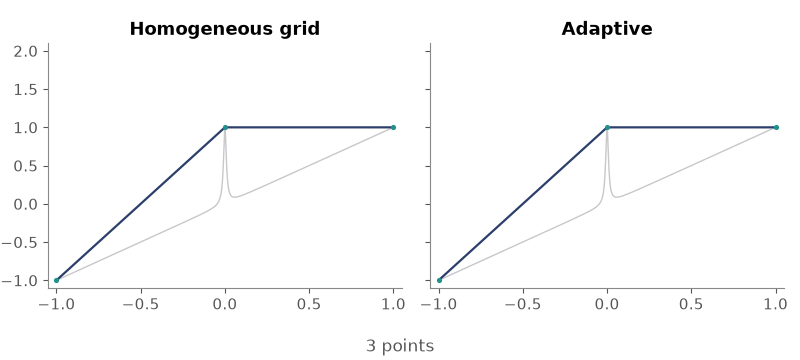
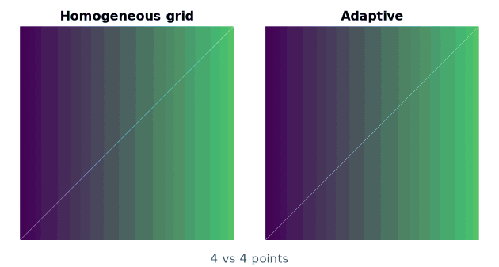
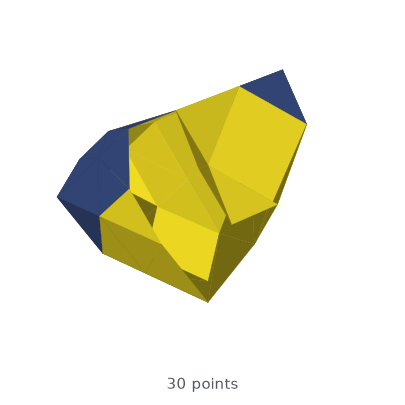

---
hide:
  - toc
---

# *Adaptive*: Parallel Active Learning of Mathematical Functions

--8<-- "README.md:badges"

<video autoplay loop muted playsinline class="adaptive-logo-video">
  <source src="_static/logo_docs.webm" type="video/webm">
</video>

--8<-- "README.md:summary"

  
  
  

[Start the tutorial](tutorial/tutorial.Learner1D.md){ .md-button .md-button--primary }
[See the examples](algorithms_and_examples.md){ .md-button }
[API reference](reference/adaptive.md){ .md-button }

--8<-- "README.md:key-features"
